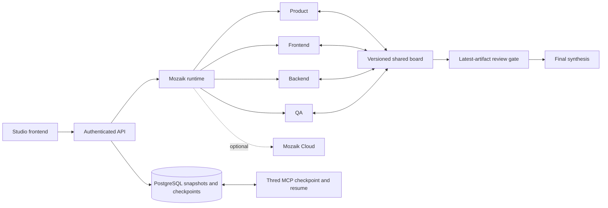

# Thred — Mozaik Studio

Studio turns a product goal into a coordinated implementation plan. Four concurrent Mozaik agents—product, frontend, backend, and QA—read and write a shared, versioned artifact board. QA reviews the latest artifacts before final synthesis. Thred persists runs and coding handoffs for another session or MCP client.

**Studio produces plans, contracts, and review evidence. It does not execute code, edit repositories, or deploy applications.** The original Thred MCP memory tools remain available.

## Run locally

Use Node.js **24+**, npm **10+**, PostgreSQL, a Clerk application with Google sign-in enabled, and an OpenAI API key. Install Node 24 using your platform installer or version manager. Create a database with your platform's PostgreSQL tools (`createdb thred`); Docker PostgreSQL is an optional alternative.

```bash
cp .env.example .env
```

PowerShell users can use `Copy-Item .env.example .env`. Configure the root `.env`:

| Variable | Purpose |
| --- | --- |
| `DATABASE_URL` | PostgreSQL connection string |
| `CLERK_PUBLISHABLE_KEY`, `CLERK_SECRET_KEY` | API authentication, from the same Clerk application |
| `NEXT_PUBLIC_CLERK_PUBLISHABLE_KEY` | Frontend key from that application |
| `OPENAI_API_KEY` | Required for Studio's OpenAI adapter |
| `MOZAIK_MODEL` | Configurable OpenAI model; default `gpt-5.4-mini` |
| `CREDENTIAL_ENCRYPTION_SECRET` | Random secret of at least 32 characters |
| `FRONTEND_ORIGIN` | `http://localhost:3000` locally |
| `NEXT_PUBLIC_API_URL` | `http://localhost:8080` locally |

Other provider settings apply to extraction/evaluations; Studio currently uses OpenAI. PostgreSQL stores all durable memory, checkpoints, and run history. Retrieval ranks up to 200 matching records lexically; it does not use vector embeddings. Indexed semantic keys, transactional current-version updates, and `SUPERSEDES` links preserve revisions.

```bash
npm install
npm run db:generate --workspace=@repo/db
npm run db:migrate --workspace=@repo/db
npm run dev
```

Alternatively start each app in a separate terminal:

```bash
npm run dev --workspace=api
```

```bash
npm run dev --workspace=frontend
```

Open [localhost:3000](http://localhost:3000), sign in, create/select a workspace, and open Studio. See [Clerk deployment setup](CLERK_DEPLOYMENT.md). Never publish keys or include credentials in goals.

## Judge walkthrough

1. Submit: **“Plan event registration for 100 attendees. Collect name and email only; no phone numbers. Coordinate frontend fields, the backend contract, capacity handling, and QA acceptance checks.”**
2. Watch the four named agent loops and interleaved shared-board tool events. Agents coordinate a registration contract; exact tool ordering and any contract mismatch depend on the model. A particular disagreement is not guaranteed.
3. Inspect board versions, QA evidence, and final synthesis. Completion requires review of the latest artifacts; edits invalidate stale review evidence.
4. Reopen the persisted run and inspect its evidence. Restore its coding handoff through MCP `thread_resume` in another session, then save progress with `thread_checkpoint`. This demonstrates a durable planning handoff, not automatic implementation.
5. Cancel a running attempt and inspect its terminal state. After process restart, interrupted work remains visible; agent execution does not automatically resume.

## Architecture and limits



The API exposes runtime capabilities and cancellation. Each workspace permits one active run, with a five-minute deadline and a 48-tool-call budget per agent. Run **one API instance** until execution moves to a shared job worker. PostgreSQL, Clerk, and OpenAI must be reachable. Treat source material as untrusted: URL filtering limits fetching but does not make external text trustworthy.

Optional Cloud telemetry uses `MOZAIK_API_KEY` and `MOZAIK_PROJECT_ID` from the same Mozaik Cloud account, with `MOZAIK_REDACTION=content`. Configure them privately and keep credentials out of screenshots. Cloud is optional and telemetry delivery is separate from local persistence.

## Original MCP tools

| Tool | Purpose |
| --- | --- |
| `thread_context` | Retrieve workspace memory, optionally with revision history |
| `thread_checkpoint` | Save coding progress and a durable handoff |
| `thread_resume` | Restore the latest unfinished coding checkpoint |

Create a workspace agent key in the dashboard and configure your MCP client:

```json
{
  "mcpServers": {
    "thred": {
      "command": "npx",
      "args": ["-y", "@thred_nick_01/thred-mcp"],
      "env": {
        "THRED_API_KEY": "<workspace agent key>",
        "THRED_API_URL": "http://localhost:8080"
      }
    }
  }
}
```

Use the same workspace key across clients. For a hosted instance replace the API URL with its deployed address.

## Verification and evaluation scope

```bash
npm test
npm run check-types --workspace=api
npm run check-types --workspace=frontend
npm run build
```

Live Studio verification also requires configured Clerk and OpenAI credentials. Automated checks do not establish model quality or production readiness.

For a real database and HTTP MCP check, apply migrations to a disposable PostgreSQL database, set `THRED_VERIFY_DATABASE_URL` to its connection string, and run `npm run verify:memory`. The check writes and cleans up only its own verification namespace. It verifies writes, revisions, isolation, current/history retrieval, and checkpoint resume without model credentials.

Historical reports are in [apps/evals/reports](apps/evals/reports). The LongMemEval V2 scale result covers **one case** (44 sessions, about 128K tokens): both Thred and the hashed-vector baseline scored 100%. This does not establish broad superiority, benchmark-wide accuracy, or production memory quality.

TypeScript · Next.js · Express · Mozaik · MCP · Prisma/PostgreSQL. [MIT license](LICENSE).
